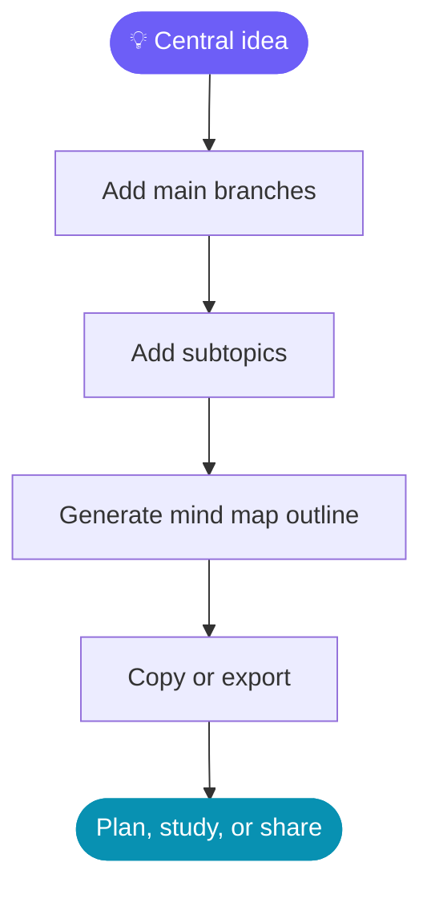

<div align="center">


<br/>

<a href="https://github.com/"></a>
<a href="#"></a>
<a href="#"></a>
<a href="#"></a>

<br/><br/>


</div>

---

## ✨ About

**Buildora Prompt Studio** is a browser-based prompt-building and productivity toolkit for developers, students, creators, freelancers, and founders.

It helps turn rough ideas into structured prompts, organise plans, map related concepts, and create useful business materials — all from one workspace.

> [!NOTE]
> Buildora's prompt tools create structured prompt text using browser-side logic and templates. They are **not themselves a generative AI model**. Copy a prompt into your preferred AI assistant to get an AI-generated response.

## 🎬 Preview

<!-- Add your own screenshots/GIFs to the repository's assets/ folder.
     Recommended: assets/buildora-demo.gif and assets/buildora-dashboard.png -->

<div align="center">
  
  <br/>
  <sub>📽️ Add a short screen recording GIF at <code>assets/buildora-demo.gif</code> to show the app in action.</sub>
</div>

<details>
  <summary><strong>🖼️ No demo GIF yet? Add screenshots here</strong></summary>
  <br/>
  
  <br/>
  <sub>Save a screenshot as <code>assets/buildora-dashboard.png</code> or update this path to match your image filename.</sub>
</details>

## 🚀 Features

<table>
<tr>
<td width="50%" valign="top">

### 🧠 Prompt Studio
- Website development prompt generator
- Product launch planner
- UX audit and accessibility review
- API design and database schema briefs
- Test plan and bug report prompts
- Code review and refactoring prompts
- Learning roadmaps
- Marketing campaign planning
- Project roadmap and milestones
- Project risk assessment

</td>
<td width="50%" valign="top">

### 🗺️ Mind Map Tools
- Start from a central idea
- Add branches and subtopics
- Generate a structured mind-map outline
- Copy the outline for notes or planning
- Export the outline as a text file

</td>
</tr>
<tr>
<td width="50%" valign="top">

### ✍️ Writing & Business Tools
- README generator
- SEO content brief
- Product listing writer
- Resume improvement brief
- Email sequence planner
- Meeting notes to action plan
- Privacy policy brief
- Slogan, social bio, and email signature helpers

</td>
<td width="50%" valign="top">

### 🧰 Productivity Utilities
- Invoice creation and print support
- Project pricing calculator
- Colour palette helper
- SEO checklist
- Saved prompt library (where supported)
- Copy and export actions for supported tools

</td>
</tr>
</table>

## ⚡ Get Started

### Option 1 — Download and open

1. Download `Buildora_PromptStudio_Full.html` from this repository.
2. Open it in a modern browser.
3. Choose a tool from the workspace.
4. Enter your details and generate the result.
5. Copy or export the result where the tool supports it.

### Option 2 — Clone the repository

```bash
git clone https://github.com/YOUR-USERNAME/Buildora-Prompt-Studio.git
cd Buildora-Prompt-Studio
```

Then open `Buildora_PromptStudio_Full.html` in your browser.

> Replace `YOUR-USERNAME` with your GitHub username and adjust the repository name if yours is different. No build step is required for the standalone HTML version.

## 🗺️ Mind Map Workflow



## 🧩 Example Use Cases

- **Build a project:** Generate a project roadmap, technical brief, and risk register.
- **Study a subject:** Break a topic into branches and subtopics using the mind map tools.
- **Start a repository:** Draft a README outline and a code-review prompt.
- **Plan a launch:** Create product, SEO, and marketing briefs.
- **Run a freelance workflow:** Prepare an invoice and organise project requirements.

## 🛠️ Built With

| Technology | Purpose |
|---|---|
| HTML5 | Application structure |
| CSS3 | Layout, styling, and responsive presentation |
| JavaScript | Browser-side interactions and prompt generation |
| Markdown / Mermaid | Project documentation and diagrams |

## 🔐 Privacy & Limitations

- The standalone prompt-building tools are designed to run in the browser.
- The prompt generators do not need an AI API key.
- Sending prompts to an external AI service is a separate action and follows that service's privacy policies.
- Do not enter passwords, API keys, or other secrets into prompts.
- Generated legal, financial, medical, or technical content should be checked before real-world use.
- Invoice tools help prepare documents; they do not process payments or guarantee tax compliance.
- Browser storage and saved-item behaviour may vary by tool and browser.

## 🗺️ Roadmap

- [ ] Interactive mind maps with draggable nodes
- [ ] Export mind maps as PNG, SVG, and PDF
- [ ] Search, tags, and folders for prompt collections
- [ ] Import/export prompt libraries
- [ ] Optional local AI integration
- [ ] More keyboard navigation and accessibility testing
- [ ] More demo GIFs and screenshots

## 🤝 Contributing

Ideas and improvements are welcome.

1. Fork this repository.
2. Create a branch: `git checkout -b feature/your-feature`
3. Make and test your changes.
4. Commit your work: `git commit -m "Add: your feature"`
5. Push your branch and open a pull request.

For bug reports, include your browser, steps to reproduce, and what you expected to happen. Please do not include private information in issues.

## 📄 License

No license is specified yet. Add a `LICENSE` file before granting others permission to reuse, modify, or redistribute this project.

## 👨‍💻 Author

**Srish Ghosh**

If you use or improve Buildora, consider giving the repository a ⭐ on GitHub.

---

<div align="center">


<sub>Made to turn ideas into structure — and structure into action.</sub>

</div>
